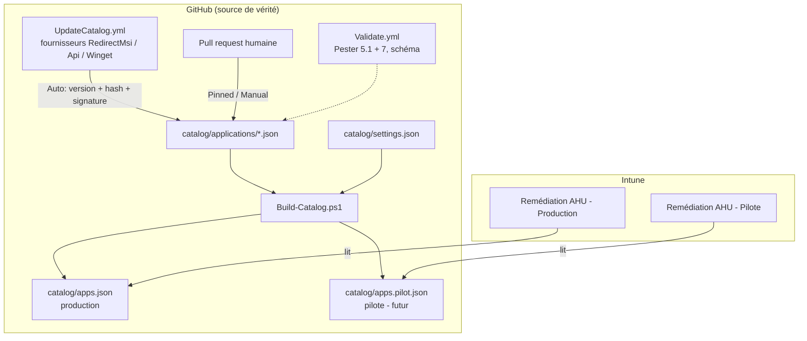

# Architecture à long terme : reproduire Patch My PC / Robopack avec GitHub Actions

## Ce que font réellement Patch My PC et Robopack

| Fonction | Patch My PC / Robopack | Équivalent AHU |
|----------|------------------------|----------------|
| Catalogue de milliers d'applications (version, URL, hash, arguments silencieux, détection) | Équipe dédiée, catalogue propriétaire | Manifestes JSON + fournisseurs dans GitHub Actions |
| Surveillance des nouvelles versions | Robots chez l'éditeur | `UpdateCatalog.yml` (planifié) |
| Vérification (hash, signature) | Oui | SHA256 + Authenticode + `SignerSubject`, au moment de la publication **et** sur le poste |
| Publication | Crée ou modifie des applications Win32 Intune (une par version, règles de détection, remplacement) | **Aucune** : un catalogue unique, lu par une remédiation générique |
| Mise à jour seulement si installé | Oui (« updates-only ») | Oui (par défaut) |
| Processus en conflit / report | Oui | `ConflictingProcesses` + `ConflictAction` |
| Anneaux de déploiement, report de N jours | Oui | Feuille de route (voir plus bas) |
| Rapports | Console Intune par application | Sortie de détection Intune + journal local |

La différence fondamentale tient à l'endroit où vit la logique. Patch My PC **publie dans Intune** (Graph API, applications Win32, `.intunewin`). AHU déplace cette logique **sur le poste** : la remédiation compare le registre au catalogue. Conséquence : aucune application Intune à recréer, aucune règle de détection à modifier et aucune permission Graph requise. C'est exactement l'objectif du projet.

Le compromis : Intune Remediations fournit des rapports moins riches qu'une application Win32 (pas de statut d'installation par version) et ne sait pas installer à la demande (Portail d'entreprise). Pour une **première installation**, les applications Win32 ou le Microsoft Store (winget) restent pertinents. AHU vise la **maintenance** des versions.

## Peut-on maintenir le catalogue automatiquement avec GitHub Actions ? Oui

Le travail de Patch My PC se résume, par application, à répondre à une question : *quelle est la dernière version, à quelle URL, avec quel hash ?* Trois familles de fournisseurs couvrent la grande majorité des applications d'un cégep :

1. **Redirection « latest »** (`RedirectMsi`, déjà implémenté) : l'éditeur expose un lien stable qui redirige vers une URL versionnée. Zoom, Chrome Enterprise MSI, Webex, etc. Coût : une requête par jour, et un téléchargement seulement quand la version change.
2. **API de l'éditeur ou GitHub Releases** : VS Code (`update.code.visualstudio.com/api/update/win32-x64/stable/latest` retourne version, URL et SHA256), Notepad++, KeePassXC et Git for Windows (GitHub Releases), Eclipse Temurin (API Adoptium), 7-Zip et WinSCP (page de téléchargement à analyser).
3. **winget-pkgs comme source de données** (la meilleure option pour passer à des dizaines d'applications) : le dépôt `microsoft/winget-pkgs` contient, pour des milliers d'applications, `InstallerUrl`, `InstallerSha256`, `InstallerType`, les arguments silencieux, `ProductCode` et souvent `AppsAndFeaturesEntries.DisplayVersion`. Un seul fournisseur générique `Winget` (`"Updater": { "Type": "Winget", "PackageIdentifier": "7zip.7zip" }`) donne accès à quasiment tout le catalogue de Robopack, gratuitement. Précautions : les manifestes sont communautaires (modérés par Microsoft). Il faut toujours revalider le hash et la signature dans GitHub Actions, filtrer `Scope: machine` et `Architecture: x64`, et vérifier la `DisplayVersion` réelle sur un poste test.

Le moteur côté poste ne change **jamais** quand on ajoute une application : on ajoute un manifeste et, au besoin, un fournisseur (`automation/Providers/<Type>.ps1`) qui retourne `Version`, `DownloadUrl` et `Sha256`.

### Contrat d'un fournisseur

```powershell
param($Manifest, $Updater, [string]$WorkDirectory)
# Retourne:
[pscustomobject]@{
    Unchanged       = $false          # $true si rien n'a changé (aucun téléchargement)
    Version         = '24.09'         # DisplayVersion attendue dans le registre
    DownloadUrl     = 'https://...'   # URL versionnée de préférence
    Sha256          = '...'
    SignatureStatus = 'Valid'
    Signer          = 'CN=...'
}
```

## Architecture recommandée



Principes :

- **Séparer données et code.** Les postes ne téléchargent que du JSON. Le code exécuté en SYSTEM est celui téléversé dans Intune (scripts générés, revus en pull request).
- **Une source de vérité par application** (`applications/*.json`), compilée en un seul `apps.json` : un téléchargement léger par poste, aucun conflit Git entre applications.
- **Les modes contrôlent l'automatisation** : `Auto` est approuvé d'avance, `Pinned` passe par une pull request (avec revue et historique Git), `Manual` sert d'inventaire seulement.
- **Défense en profondeur** : hash et signature vérifiés deux fois (GitHub Actions, puis le poste). `SignerSubject` empêche une URL détournée d'installer un binaire signé par quelqu'un d'autre.
- **Interrupteur global** (`Settings.Paused`) et désactivation par application (`Enabled: false`), effectifs en quelques minutes sur tout le parc.

## Feuille de route

1. **MVP (fait)** : moteur, Zoom en `Auto`, catalogue, scripts Intune, CI.
2. **Anneaux pilote / production** : `Build-Catalog.ps1` produit `apps.pilot.json` (versions `Auto` immédiates) et `apps.json` (versions `Auto` publiées depuis au moins N jours, via un champ `PilotVersion` + `PromotedOn` dans le manifeste). Deux remédiations Intune, une par groupe, qui ne diffèrent que par `$AhuCatalogUrl`.
3. **Fournisseurs** : `VSCodeApi`, `GitHubRelease` (Notepad++, Git), puis `Winget` générique (7-Zip, WinSCP, Temurin, VLC…).
4. **Rétrogradation contrôlée pour `Pinned`** (`AllowDowngrade` + `UninstallArguments`).
5. **Installations par utilisateur** (Zoom, Teams classic) : détection dans `HKU\<SID>` et migration vers l'installation machine.
6. **Rapports** : extraire la sortie de détection via Graph (`deviceHealthScriptStates`) dans un tableau Power BI ou un CSV hebdomadaire.
7. **Signature de code** : signer `intune/*.ps1` avec un certificat interne et activer « Appliquer la vérification de signature ».

## Pourquoi un seul workflow plutôt qu'un fichier par application

Avec un `UpdateZoom.yml`, un `UpdateVSCode.yml`, etc., chaque workflow modifie `apps.json` et pousse sur `main` de son côté. Lorsqu'ils s'exécutent en même temps, les push entrent en conflit, et la maintenance grossit avec le nombre d'applications. Un seul `UpdateCatalog.yml` avec une matrice générée à partir des manifestes s'exécute en parallèle (une tâche par application), publie **un seul commit** et permet quand même de cibler une application en lancement manuel (`app: Zoom`). Ajouter une application ne demande aucun nouveau YAML.
