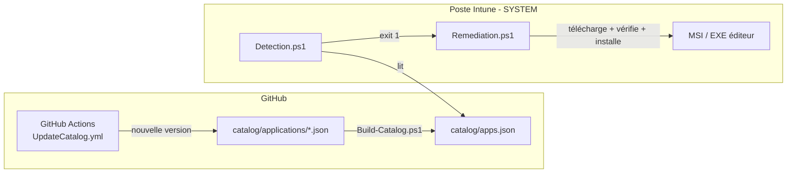

# AHU – Application Hub Updater

Mise à jour automatique d'applications Windows avec **GitHub + Intune Remediations** uniquement : aucune dépendance SCCM, serveur interne ou Azure.

Les postes lisent un catalogue JSON publié sur GitHub. Ce catalogue détermine, pour chaque application, la version cible, le mode de gestion, l'URL de téléchargement et la méthode d'installation. **Mettre à jour une application = modifier un JSON**. On ne recrée pas d'application Intune et on ne touche pas aux règles de détection.



## Structure

```
AHU
├── catalog
│   ├── apps.json                  # GÉNÉRÉ – anneau production, lu par les postes
│   ├── apps.pilot.json            # GÉNÉRÉ – anneau pilote
│   ├── settings.json              # réglages globaux (Paused)
│   ├── hooks                      # SOURCE – scripts avant/après : hooks/<Id>/PreInstall.ps1, PostInstall.ps1
│   └── applications               # SOURCE DE VÉRITÉ – un fichier par application
│       ├── zoom.json
│       ├── 7-zip.json
│       ├── sharex.json
│       ├── adobereader.json
│       ├── java.json
│       └── vscode.json
├── engine
│   ├── Invoke-AppUpdate.ps1       # point d'entrée (tests locaux, dépannage)
│   ├── Detect-App.ps1             # détection d'une ou plusieurs applications
│   ├── Install-App.ps1            # remédiation d'une ou plusieurs applications
│   └── Modules
│       ├── Logging.psm1           # journal C:\ProgramData\AHU\Logs\AHU.log
│       ├── Version.psm1           # comparaison de versions
│       ├── Catalog.psm1           # lecture, cache et validation du catalogue
│       ├── Detection.psm1         # registre + décision de conformité
│       ├── Hooks.psm1             # scripts avant/après installation (fonctions de type PSADT)
│       ├── Installer.psm1         # téléchargement, SHA256, signature, MSI/EXE
│       └── Engine.psm1            # orchestration Detect / Remediate
├── intune
│   ├── Detection.ps1              # GÉNÉRÉ – production, à téléverser dans Intune
│   ├── Remediation.ps1            # GÉNÉRÉ – production
│   ├── Detection-Pilote.ps1       # GÉNÉRÉ – anneau pilote
│   └── Remediation-Pilote.ps1     # GÉNÉRÉ – anneau pilote
├── automation                     # exécuté par GitHub Actions (PowerShell 7)
│   ├── AhuAutomation.psm1
│   ├── Providers                  # fournisseurs de versions: RedirectMsi (Zoom), GitHubRelease (7-Zip)
│   ├── Update-AppManifest.ps1
│   ├── Promote-App.ps1            # pilote -> production
│   ├── Get-UpdatableApp.ps1
│   ├── Build-Catalog.ps1
│   ├── Build-IntuneScripts.ps1
│   ├── Test-Catalog.ps1
│   └── Get-InstallerInfo.ps1      # aide pour remplir un manifeste Pinned
├── .github/workflows
│   ├── UpdateCatalog.yml          # détection des nouvelles versions + pull request
│   ├── Promote.yml                # promotion pilote -> production (pull request)
│   └── Validate.yml               # tests Pester 5.1/7 + validation du catalogue
├── tests                          # Pester 5
└── docs
    ├── README.md
    └── ARCHITECTURE.md            # analyse Patch My PC / Robopack, feuille de route
```

## Modes

| Mode | Comportement | Exemples |
|------|--------------|----------|
| `Auto` | Toujours la dernière version approuvée. GitHub Actions met `Version` à jour automatiquement. | Zoom, VS Code, 7-Zip, WinSCP, Notepad++ |
| `Pinned` | Version précise fixée par un humain (pull request). Pas de retour arrière si une version plus récente est installée. | Adobe Reader, Java (Oracle), Antidote, AutoCAD, MATLAB, SPSS |
| `Manual` | Application connue du catalogue (inventaire dans le journal), aucune action. | Applications en évaluation |

Par défaut, AHU **met à jour seulement les applications déjà installées**, comme Patch My PC. Une application absente est conforme, sauf si `InstallIfMissing` vaut `true`.

## Manifeste d'application (`catalog/applications/<id>.json`)

```json
{
  "Id": "Zoom",
  "Name": "Zoom Workplace (64 bits)",
  "Mode": "Auto",
  "Version": "7.2.51704",
  "DownloadUrl": "https://cdn.zoom.us/prod/7.2.5.51704/x64/ZoomInstallerFull.msi",
  "Sha256": "8E81E0D7DC401880C4CDFD14DB8BED51308608B7AA67FA1E2CA31CCAA71CAD93",
  "InstallerType": "MSI",
  "InstallArguments": "/qn /norestart",
  "DetectionName": ["Zoom Workplace (64-bit)", "Zoom (64-bit)", "=Zoom"],
  "ReplaceUserInstall": true,
  "DetectionExclude": ["*VDI*", "*Plugin*", "*Rooms*"],
  "DetectionPublisher": "Zoom*",
  "InstallIfMissing": false,
  "ConflictingProcesses": ["Zoom"],
  "ConflictAction": "Skip",
  "SignerSubject": "Zoom",
  "Updater": { "Type": "RedirectMsi", "Url": "https://zoom.us/client/latest/ZoomInstallerFull.msi?archType=x64" }
}
```

| Champ | Obligatoire | Description |
|-------|-------------|-------------|
| `Id` | oui | Identifiant unique. Le fichier doit s'appeler `<id en minuscules>.json`. |
| `Mode` | oui | `Auto`, `Pinned` ou `Manual`. |
| `DetectionName` | oui | Nom(s) dans « Programmes et fonctionnalités ». Sans `*` ni `?`, la correspondance est partielle (`Workplace` = `*Workplace*`). Un préfixe `=` exige le nom exact (`=Zoom` ne prend pas « Zoom Outlook Plugin »). Les copies par utilisateur (ruche chargée) sont vues aussi. |
| `DetectionExclude` | non | Noms à ignorer (plugins, VDI…). |
| `DetectionPublisher` | non | Filtre sur l'éditeur. |
| `Version` | Auto/Pinned | Version **telle qu'écrite dans le registre** (`DisplayVersion`). |
| `DownloadUrl` | Auto/Pinned | URL https de l'installateur. Idéalement versionnée, pour que le SHA256 reste valide. |
| `Sha256` | recommandé | Vérifié avant l'installation. |
| `InstallerType` | Auto/Pinned | `MSI` (`msiexec /i … /L*v`) ou `EXE`. |
| `InstallArguments` | non | Arguments silencieux. |
| `Installers` | non | Installateurs par langue : `[{ "Locale": "fr-CA", "DownloadUrl": "...", "Sha256": "...", "InstallerType": "EXE", "InstallArguments": "..." }]`. Ordre de choix : langue du système (lue sous SYSTEM), puis fr-CA, fr-FR, en-US. Sans correspondance, les champs du haut sont utilisés. Les champs absents d'une variante reprennent ceux du haut. |
| `InstallIfMissing` | non | `false` par défaut : mise à jour seulement. |
| `ReplaceUserInstall` | non | Avant l'installation machine, désinstalle les copies par utilisateur détectées (Zoom personnel dans `%AppData%`). |
| `ConflictingProcesses` | non | Processus qui empêchent l'installation (ex. réunion Zoom en cours). |
| `ConflictAction` | non | `Skip` (défaut : report au prochain cycle) ou `Kill`. |
| `RequireSignature` | non | `true` par défaut : signature Authenticode valide exigée (poste **et** pipeline). Mettre `false` seulement si l'éditeur ne signe pas (ex. 7-Zip) : le SHA256 reste vérifié, mais l'intégrité repose alors sur la source (dépôt officiel). Documenter la raison dans `Notes`. |
| `SignerSubject` | non | Texte attendu dans le sujet du certificat de signature. |
| `SuccessExitCodes` | non | Défaut `[0, 1641, 3010]`. |
| `InstallTimeoutMinutes` | non | Défaut `30`. |
| `Enabled` | non | `false` pour désactiver une application sans la retirer. |
| `Updater` | non | Fournisseur utilisé par GitHub Actions (jamais publié aux postes). |

> **Piège des versions** : Zoom publie `7.2.5.51704` dans son URL, mais le registre contient `7.2.51704` (la `ProductVersion` du MSI). Le fournisseur `RedirectMsi` lit donc la version **dans le MSI**, jamais dans l'URL.

`catalog/settings.json` contient `"Paused": true|false`. C'est un interrupteur global : à `true`, tous les postes cessent d'installer quoi que ce soit.

## Scripts avant / après installation

Quand l'installation silencieuse ne suffit pas, une application peut avoir un script **avant** et/ou un script **après**, en PowerShell, dans le dépôt :

```
catalog/hooks/<Id>/PreInstall.ps1     # avant l'installateur
catalog/hooks/<Id>/PostInstall.ps1    # après l'installateur
```

`<Id>` est l'`Id` du manifeste (ex. `Zoom`). **Rien à déclarer dans le manifeste** : `Build-Catalog.ps1` détecte les fichiers et publie leur URL et leur SHA256 dans les deux catalogues. Champ optionnel du manifeste : `HookTimeoutMinutes` (10 par défaut, par script).

**Déroulement** (pour une application dont AHU doit installer ou mettre à jour la version) :

1. Téléchargement et vérification (SHA256, signature) de l'installateur.
2. Téléchargement et vérification du SHA256 des scripts. Si un hash ne correspond pas, **rien n'est modifié** sur le poste.
3. `PreInstall.ps1`. S'il échoue, **l'installation est annulée** (visible dans le journal et dans Intune).
4. Installateur, puis vérification de la version installée.
5. `PostInstall.ps1`. S'il échoue, l'application reste installée, mais la remédiation est **signalée en échec**. Le script n'est pas rejoué automatiquement, car la détection voit déjà la bonne version.

Les scripts s'exécutent seulement quand AHU installe, jamais à chaque détection. Ils tournent dans un **processus séparé** (même version de PowerShell que le moteur, compte SYSTEM, 64 bits) avec un délai maximum : un `exit N` ou une erreur ne peut pas arrêter le moteur. Succès = code 0 ; `throw` ou `exit N` (N différent de 0) = échec. Tout ce que le script écrit est copié dans `AHU.log` avec le préfixe `[PreInstall]` ou `[PostInstall]`.

**Variables disponibles** (noms inspirés de PSAppDeployToolkit v3) : `$appId`, `$appName`, `$appVersion` (version cible), `$installedVersion` (version avant la mise à jour, vide si absente), `$installPhase`, `$installerPath`, `$dirAhuLogs`, `$envProgramFiles`, `$envProgramFilesX86`, `$envProgramData`, `$envCommonDesktop`, `$envCommonStartMenu`, `$envCommonStartMenuPrograms`, `$envCommonStartUp`, `$envWinDir`, `$envSystemDrive`, `$envTemp`.

**Fonctions disponibles** (noms de PSADT v3, avec les alias v4 `*-ADT*` pour les mêmes opérations) :

| Fonction | Rôle |
|---|---|
| `Write-Log -Message` | écrit dans le journal (`-Severity` 1 info, 2 avertissement, 3 erreur) |
| `Remove-File -Path [-Recurse]` | supprime des fichiers (jokers permis, ex. `"$envCommonDesktop\Zoom*.lnk"`) ; rien si absent |
| `Remove-Folder -Path` | supprime un dossier et son contenu |
| `Copy-File -Path -Destination [-Recurse]`, `New-Folder -Path` | copie, création de dossier |
| `Set-RegistryKey -Key -Name -Value -Type` | crée la clé si besoin et définit la valeur (`String`, `DWord`, `QWord`, `ExpandString`, `MultiString`, `Binary`) |
| `Get-RegistryKey -Key [-Value]`, `Remove-RegistryKey -Key [-Name] [-Recurse]` | lecture, suppression |
| `Get-InstalledApplication -Name [-Exact]` | cherche dans les entrées de désinstallation HKLM |
| `Execute-Process -Path -Parameters [-IgnoreExitCodes]` | lance un programme et attend ; code non nul = erreur |

Différence avec PSADT : ces fonctions **arrêtent le script sur erreur** par défaut. Ajouter `-ContinueOnError $true` pour consigner un avertissement et continuer. Les autres fonctions de PSADT (fenêtres, `Show-InstallationWelcome`, etc.) ne sont **pas** disponibles : les scripts tournent sans session utilisateur. Les clés `HKCU` visent le compte SYSTEM, donc sans effet pour les utilisateurs : utiliser `HKLM`.

Exemple, `catalog/hooks/Zoom/PostInstall.ps1` :

```powershell
Write-Log "Zoom $appVersion installe (version precedente: $installedVersion)"
Remove-File -Path "$envCommonDesktop\Zoom*.lnk" -ContinueOnError $true
Set-RegistryKey -Key 'HKLM:\SOFTWARE\Exemple\Zoom' -Name 'Option' -Value 1 -Type DWord
```

**Règles du fichier** (vérifiées par `Test-Catalog.ps1`) : syntaxe PowerShell valide, et ASCII pur ou UTF-8 **avec BOM** (Windows PowerShell 5.1 lit sinon les accents en ANSI). Le dépôt stocke ces fichiers avec des fins de ligne LF (`.gitattributes`), car le poste les télécharge tels que GitHub les sert.

**Test local d'un script** :

```powershell
foreach ($m in 'Logging', 'Version', 'Catalog', 'Hooks') { Import-Module .\engine\Modules\$m.psm1 -Force -Global -DisableNameChecking }
Initialize-AhuLog -LogDirectory $env:TEMP\AHU\Logs | Out-Null
$app = [pscustomobject]@{ Id = 'Zoom'; Name = 'Zoom'; Version = '7.2.51704' }
Invoke-AhuHook -App $app -Phase PostInstall -ScriptPath .\catalog\hooks\Zoom\PostInstall.ps1 -DataRoot $env:TEMP\AHU -Verbose
Get-Content $env:TEMP\AHU\Logs\AHU.log -Tail 20
```

**Attention aux anneaux** : il y a un seul fichier par script. Une modification fusionnée dans `main` s'applique donc **aux deux anneaux** (pilote et production) dès que le catalogue publié change. Teste le script en local avant de fusionner.

## Anneaux : pilote et production

Chaque application a deux versions publiées, selon l'anneau :

| Fichier publié | Anneau | Contenu |
|---|---|---|
| `catalog/apps.pilot.json` | **Pilote** | Champs de premier niveau du manifeste (`Version`, `DownloadUrl`, `Sha256`). Mis à jour par le bot, via une PR par version. |
| `catalog/apps.json` | **Production** | Bloc `Production` du manifeste (`Version`, `DownloadUrl`, `Sha256`). Modifié seulement par une promotion explicite. |

Règles de publication (`automation/Build-Catalog.ps1`) :

- Une application `Auto` ou `Pinned` **sans** bloc `Production` n'apparaît que dans le pilote (avertissement affiché).
- Une application `Manual` (inventaire) apparaît dans les deux anneaux.
- Les blocs `Production` et `Updater` ne sont jamais publiés aux postes.

**Promouvoir une version en production** : quand la version pilote a tourné sans problème, lance le workflow **Promouvoir** (`Actions > Promouvoir > Run workflow`, champ `app` = `Zoom`). Il ouvre une PR `Promouvoir en production : Zoom <version>`. Fusionne-la pour que la production reçoive la version. Si la version pilote est déjà en production, le workflow ne fait rien.

Pour promouvoir en local : `pwsh ./automation/Promote-App.ps1 -AppId Zoom`, puis `pwsh ./automation/Build-Catalog.ps1`.

**Intune : deux remédiations**

1. **AHU - Pilote** : scripts `intune/Detection-Pilote.ps1` et `intune/Remediation-Pilote.ps1`, affectés au **groupe pilote**.
2. **AHU - Production** : scripts `intune/Detection.ps1` et `intune/Remediation.ps1`, affectés au **reste des postes**. **Exclure le groupe pilote** de cette remédiation, sinon le même poste exécute les deux (le résultat est le même, mais c'est inutile et ça double les journaux).

Ces scripts sont régénérés par `automation/Build-IntuneScripts.ps1`. Si le moteur change, re-téléverse les quatre scripts.

## Déploiement Intune

1. Le dépôt doit être **public** (les postes lisent `https://raw.githubusercontent.com/YannRicher/AHU/main/catalog/apps.json` sans authentification). Ne jamais mettre de jeton dans un script de remédiation.
2. Intune > **Appareils > Scripts et corrections (Remediations) > Créer** :
   - Script de détection : `intune/Detection.ps1`
   - Script de correction : `intune/Remediation.ps1`
   - Exécuter avec les informations d'identification de connexion : **Non** (SYSTEM)
   - Vérification de la signature du script : **Non**
   - PowerShell 64 bits : **Oui**
3. Affecter à un groupe pilote, avec une planification **toutes les 8 heures** ou **quotidienne**.
4. Le résultat apparaît dans la colonne « Sortie de détection » (ex. `Non conforme - Zoom: version 7.1.48953 detectee - mise a jour requise vers 7.2.51704 (mode Auto)`).

Dans le haut des scripts, `$AhuAppIds = @()` traite **toutes** les applications du catalogue présentes sur le poste : une seule remédiation suffit et une nouvelle application n'exige **aucune** modification dans Intune. Pour un rapport par application (ex. une remédiation « AHU – Zoom »), utiliser une copie avec `$AhuAppIds = @('Zoom')`.

Les scripts Intune sont **autonomes** : les modules y sont intégrés par `automation/Build-IntuneScripts.ps1`. Les postes ne téléchargent que des données (le catalogue), jamais du code. On les régénère et les re-téléverse seulement quand le moteur change, pas quand une application change.

## Journalisation

`C:\ProgramData\AHU\Logs\AHU.log` (rotation à 5 Mo vers `AHU.log.old`) :

```
2026-11-16 10:15:00 - ===== AHU Remediate - moteur 1.3.0 (build c7b8fda4) - PowerShell 5.1.26100 (64 bits) - compte AUTORITE NT\Système =====
2026-11-16 10:15:00 - Catalogue charge depuis https://raw.githubusercontent.com/... (4 application(s))
2026-11-16 10:15:00 - Zoom: version 7.1.48953 detectee - mise a jour requise vers 7.2.51704 (mode Auto)
2026-11-16 10:15:01 - Zoom: telechargement demarre (https://cdn.zoom.us/prod/7.2.5.51704/x64/ZoomInstallerFull.msi)
2026-11-16 10:15:40 - Zoom: SHA256 verifie
2026-11-16 10:15:41 - Zoom: signature valide (CN=Zoom Communications, Inc., ...)
2026-11-16 10:16:12 - Zoom: installation completee, version 7.2.51704 detectee
```

La première ligne de chaque exécution indique la **version du moteur** et son **build** (empreinte du code, identique dans les 4 scripts Intune) : cela permet de savoir exactement quel moteur a roulé sur un poste. Incrémenter `$script:AhuEngineVersion` dans `engine/Modules/Engine.psm1` à chaque changement du moteur ; le build est recalculé par `automation/Build-IntuneScripts.ps1`.

Les journaux MSI détaillés sont écrits dans `C:\ProgramData\AHU\Logs\<Id>-<version>-msi.log`. Le dernier catalogue valide est conservé dans `C:\ProgramData\AHU\Cache\apps.json` : si GitHub est inaccessible, le poste utilise cette copie.

> Les messages sont volontairement sans accents : Windows PowerShell 5.1 lit les scripts UTF-8 sans BOM comme de l'ANSI. Un test Pester impose l'ASCII pur dans `engine/` et `intune/`.

## GitHub Actions

- **`UpdateCatalog.yml`** : chaque jour (ou manuellement, pour une seule application), une tâche matricielle par application `Auto` interroge son fournisseur. Pour Zoom, le fournisseur résout la redirection « latest » (requête légère). Si l'URL a changé, il télécharge le MSI et en lit `ProductVersion`, SHA256 et signature, qu'il valide contre `SignerSubject`. Une tâche finale regénère `apps.json` et fait **un seul commit**, ce qui évite les conflits entre applications.
- **`Validate.yml`** : à chaque push ou pull request, il lance les tests Pester sous Windows PowerShell 5.1 **et** PowerShell 7, valide les manifestes et vérifie que `apps.json` et `intune/*.ps1` ont bien été regénérés.

Si une règle de protection de branche est active sur `main`, autoriser `github-actions[bot]` à pousser, ou adapter le workflow pour ouvrir une pull request.

## Notifications

- **Nouvelle version détectée** : `UpdateCatalog.yml` ouvre une **pull request** `Publier : <Application> <version>`, assignée au propriétaire du dépôt. Tu reçois un courriel.
  - **Fusionner** la PR : la version est publiée, les postes l'appliquent au prochain cycle Intune si la remédiation est active.
  - **Fermer sans fusionner** : la version est refusée, et elle n'est plus reproposée.
  - La PR se ferme toute seule au merge : pas d'issue à fermer à la main.
  - Les tests Pester tournent dans le workflow avant l'ouverture de la PR.
  - Prérequis : dans **Paramètres > Actions > Général**, coche **Autoriser les actions GitHub à créer et approuver des pull requests**.
- **Échec d'un workflow** : GitHub envoie un courriel par défaut. Vérifie les réglages dans **Paramètres de notifications**.
- **Résultat sur les postes** : seulement dans le portail Intune (remédiation, sorties) et dans le journal local. Un poste ne peut pas envoyer d'alerte sans jeton, donc il n'y a pas de notification.

## Ajouter une application

**Pinned** (Adobe Reader, MATLAB…) :

```powershell
pwsh ./automation/Get-InstallerInfo.ps1 -Uri 'https://.../AcroRdrDCx64.exe'   # version, SHA256, signataire
# remplir catalog/applications/adobereader.json : Mode=Pinned, Version, DownloadUrl, Sha256, InstallerType, InstallArguments
pwsh ./automation/Build-Catalog.ps1
pwsh ./automation/Test-Catalog.ps1
```

Vérifier sur un poste test que `Version` correspond **exactement** à la `DisplayVersion` du registre après l'installation. Pour un EXE, c'est la seule source fiable.

**Auto** : créer le manifeste avec une section `Updater`. Fournisseurs disponibles :

- `RedirectMsi` : un lien « latest » stable qui redirige vers un MSI versionné (Zoom).
- `GitHubRelease` : le dernier asset d'une release GitHub publique, avec `Repo` (ex. `ip7z/7zip`) et `AssetPattern` (ex. `7z*-x64.exe`) (7-Zip).
Sinon, ajouter `automation/Providers/<Type>.ps1` (voir `ARCHITECTURE.md`). Une nouvelle application Auto arrive d'abord dans l'anneau pilote ; la promotion en production est manuelle (voir « Anneaux »).

## Tests locaux

```powershell
# Détection sur ce poste avec le catalogue local, journal dans %TEMP%
powershell.exe -ExecutionPolicy Bypass -File .\engine\Invoke-AppUpdate.ps1 -Action Detect -CatalogPath .\catalog\apps.json -DataRoot $env:TEMP\AHU -Verbose

# Remédiation réelle (admin), une seule application
powershell.exe -ExecutionPolicy Bypass -File .\engine\Install-App.ps1 -AppId Zoom

# Tests unitaires (Pester 5)
Invoke-Pester -Path .\tests
```

Pour reproduire exactement le contexte Intune (SYSTEM) : `psexec -s -i powershell.exe`.

## Limites du MVP

- Installations **machine** seulement (HKLM). Les installations par utilisateur, fréquentes avec Zoom, ne sont pas visées.
- Pas de rétrogradation : un poste en version plus récente qu'une version `Pinned` est déclaré conforme.
- Anneaux pilote / production en place, sans délai automatique entre les deux : la promotion est manuelle (voir `ARCHITECTURE.md`).
- `ConflictAction: Skip` : si Zoom reste ouvert en permanence, la mise à jour se fera quand Zoom sera fermé (soir, redémarrage). Utiliser `Kill` pour forcer.
