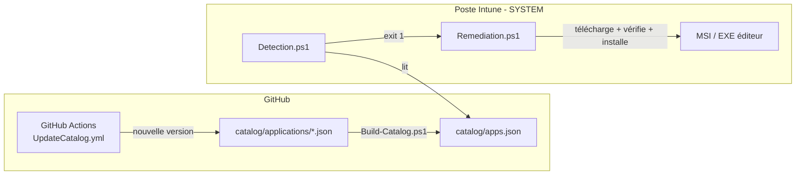

# AHU – Application Hub Updater

Mise à jour automatique d'applications Windows avec **GitHub + Intune Remediations** uniquement : aucune dépendance SCCM, serveur interne ou Azure.

Les postes lisent un catalogue JSON publié sur GitHub. Ce catalogue détermine, pour chaque application, la version cible, le mode de gestion, l'URL de téléchargement et la méthode d'installation. **Mettre à jour une application = modifier un JSON**. On ne recrée pas d'application Intune et on ne touche pas aux règles de détection.



## Structure

```
AHU
├── catalog
│   ├── apps.json                  # GÉNÉRÉ – lu par les postes
│   ├── settings.json              # réglages globaux (Paused)
│   └── applications               # SOURCE DE VÉRITÉ – un fichier par application
│       ├── zoom.json
│       ├── adobereader.json
│       ├── java.json
│       └── vscode.json
├── engine
│   ├── Invoke-AppUpdate.ps1       # point d'entrée (tests locaux, dépannage)
│   ├── Detect-App.ps1             # détection d'une ou plusieurs applications
│   ├── Install-App.ps1            # remédiation d'une ou plusieurs applications
│   └── Modules
│       ├── Logging.psm1           # journal C:\ProgramData\AHU\Logs\AHU.log
│       ├── Version.psm1           # comparaison de versions
│       ├── Catalog.psm1           # lecture, cache et validation du catalogue
│       ├── Detection.psm1         # registre + décision de conformité
│       ├── Installer.psm1         # téléchargement, SHA256, signature, MSI/EXE
│       └── Engine.psm1            # orchestration Detect / Remediate
├── intune
│   ├── Detection.ps1              # GÉNÉRÉ – à téléverser dans Intune
│   └── Remediation.ps1            # GÉNÉRÉ – à téléverser dans Intune
├── automation                     # exécuté par GitHub Actions (PowerShell 7)
│   ├── AhuAutomation.psm1
│   ├── Providers/RedirectMsi.ps1  # fournisseur de versions (Zoom)
│   ├── Update-AppManifest.ps1
│   ├── Get-UpdatableApp.ps1
│   ├── Build-Catalog.ps1
│   ├── Build-IntuneScripts.ps1
│   ├── Test-Catalog.ps1
│   └── Get-InstallerInfo.ps1      # aide pour remplir un manifeste Pinned
├── .github/workflows
│   ├── UpdateCatalog.yml          # détection des nouvelles versions + commit
│   └── Validate.yml               # tests Pester 5.1/7 + validation du catalogue
├── tests                          # Pester 5
└── docs
    ├── README.md
    └── ARCHITECTURE.md            # analyse Patch My PC / Robopack, feuille de route
```

## Modes

| Mode | Comportement | Exemples |
|------|--------------|----------|
| `Auto` | Toujours la dernière version approuvée. GitHub Actions met `Version` à jour automatiquement. | Zoom, VS Code, 7-Zip, WinSCP, Notepad++ |
| `Pinned` | Version précise fixée par un humain (pull request). Pas de retour arrière si une version plus récente est installée. | Adobe Reader, Java, Antidote, AutoCAD, MATLAB, SPSS |
| `Manual` | Application connue du catalogue (inventaire dans le journal), aucune action. | Applications en évaluation |

Par défaut, AHU **met à jour seulement les applications déjà installées**, comme Patch My PC. Une application absente est conforme, sauf si `InstallIfMissing` vaut `true`.

## Manifeste d'application (`catalog/applications/<id>.json`)

```json
{
  "Id": "Zoom",
  "Name": "Zoom Workplace (64 bits)",
  "Mode": "Auto",
  "Version": "7.2.51704",
  "DownloadUrl": "https://cdn.zoom.us/prod/7.2.5.51704/x64/ZoomInstallerFull.msi",
  "Sha256": "8E81E0D7DC401880C4CDFD14DB8BED51308608B7AA67FA1E2CA31CCAA71CAD93",
  "InstallerType": "MSI",
  "InstallArguments": "/qn /norestart",
  "DetectionName": ["Zoom Workplace (64-bit)", "Zoom (64-bit)", "=Zoom"],
  "ReplaceUserInstall": true,
  "DetectionExclude": ["*VDI*", "*Plugin*", "*Rooms*"],
  "DetectionPublisher": "Zoom*",
  "InstallIfMissing": false,
  "ConflictingProcesses": ["Zoom"],
  "ConflictAction": "Skip",
  "SignerSubject": "Zoom",
  "Updater": { "Type": "RedirectMsi", "Url": "https://zoom.us/client/latest/ZoomInstallerFull.msi?archType=x64" }
}
```

| Champ | Obligatoire | Description |
|-------|-------------|-------------|
| `Id` | oui | Identifiant unique. Le fichier doit s'appeler `<id en minuscules>.json`. |
| `Mode` | oui | `Auto`, `Pinned` ou `Manual`. |
| `DetectionName` | oui | Nom(s) dans « Programmes et fonctionnalités ». Sans `*` ni `?`, la correspondance est partielle (`Workplace` = `*Workplace*`). Un préfixe `=` exige le nom exact (`=Zoom` ne prend pas « Zoom Outlook Plugin »). Les copies par utilisateur (ruche chargée) sont vues aussi. |
| `DetectionExclude` | non | Noms à ignorer (plugins, VDI…). |
| `DetectionPublisher` | non | Filtre sur l'éditeur. |
| `Version` | Auto/Pinned | Version **telle qu'écrite dans le registre** (`DisplayVersion`). |
| `DownloadUrl` | Auto/Pinned | URL https de l'installateur. Idéalement versionnée, pour que le SHA256 reste valide. |
| `Sha256` | recommandé | Vérifié avant l'installation. |
| `InstallerType` | Auto/Pinned | `MSI` (`msiexec /i … /L*v`) ou `EXE`. |
| `InstallArguments` | non | Arguments silencieux. |
| `InstallIfMissing` | non | `false` par défaut : mise à jour seulement. |
| `ReplaceUserInstall` | non | Avant l'installation machine, désinstalle les copies par utilisateur détectées (Zoom personnel dans `%AppData%`). |
| `ConflictingProcesses` | non | Processus qui empêchent l'installation (ex. réunion Zoom en cours). |
| `ConflictAction` | non | `Skip` (défaut : report au prochain cycle) ou `Kill`. |
| `RequireSignature` | non | `true` par défaut : signature Authenticode valide exigée. |
| `SignerSubject` | non | Texte attendu dans le sujet du certificat de signature. |
| `SuccessExitCodes` | non | Défaut `[0, 1641, 3010]`. |
| `InstallTimeoutMinutes` | non | Défaut `30`. |
| `Enabled` | non | `false` pour désactiver une application sans la retirer. |
| `Updater` | non | Fournisseur utilisé par GitHub Actions (jamais publié aux postes). |

> **Piège des versions** : Zoom publie `7.2.5.51704` dans son URL, mais le registre contient `7.2.51704` (la `ProductVersion` du MSI). Le fournisseur `RedirectMsi` lit donc la version **dans le MSI**, jamais dans l'URL.

`catalog/settings.json` contient `"Paused": true|false`. C'est un interrupteur global : à `true`, tous les postes cessent d'installer quoi que ce soit.

## Déploiement Intune

1. Le dépôt doit être **public** (les postes lisent `https://raw.githubusercontent.com/YannRicher/AHU/main/catalog/apps.json` sans authentification). Ne jamais mettre de jeton dans un script de remédiation.
2. Intune > **Appareils > Scripts et corrections (Remediations) > Créer** :
   - Script de détection : `intune/Detection.ps1`
   - Script de correction : `intune/Remediation.ps1`
   - Exécuter avec les informations d'identification de connexion : **Non** (SYSTEM)
   - Vérification de la signature du script : **Non**
   - PowerShell 64 bits : **Oui**
3. Affecter à un groupe pilote, avec une planification **toutes les 8 heures** ou **quotidienne**.
4. Le résultat apparaît dans la colonne « Sortie de détection » (ex. `Non conforme - Zoom: version 7.1.48953 detectee - mise a jour requise vers 7.2.51704 (mode Auto)`).

Dans le haut des scripts, `$AhuAppIds = @()` traite **toutes** les applications du catalogue présentes sur le poste : une seule remédiation suffit et une nouvelle application n'exige **aucune** modification dans Intune. Pour un rapport par application (ex. une remédiation « AHU – Zoom »), utiliser une copie avec `$AhuAppIds = @('Zoom')`.

Les scripts Intune sont **autonomes** : les modules y sont intégrés par `automation/Build-IntuneScripts.ps1`. Les postes ne téléchargent que des données (le catalogue), jamais du code. On les régénère et les re-téléverse seulement quand le moteur change, pas quand une application change.

## Journalisation

`C:\ProgramData\AHU\Logs\AHU.log` (rotation à 5 Mo vers `AHU.log.old`) :

```
2026-11-16 10:15:00 - ===== AHU Remediate - PowerShell 5.1.26100 (64 bits) - compte AUTORITE NT\Système =====
2026-11-16 10:15:00 - Catalogue charge depuis https://raw.githubusercontent.com/... (4 application(s))
2026-11-16 10:15:00 - Zoom: version 7.1.48953 detectee - mise a jour requise vers 7.2.51704 (mode Auto)
2026-11-16 10:15:01 - Zoom: telechargement demarre (https://cdn.zoom.us/prod/7.2.5.51704/x64/ZoomInstallerFull.msi)
2026-11-16 10:15:40 - Zoom: SHA256 verifie
2026-11-16 10:15:41 - Zoom: signature valide (CN=Zoom Communications, Inc., ...)
2026-11-16 10:16:12 - Zoom: installation completee, version 7.2.51704 detectee
```

Les journaux MSI détaillés sont écrits dans `C:\ProgramData\AHU\Logs\<Id>-<version>-msi.log`. Le dernier catalogue valide est conservé dans `C:\ProgramData\AHU\Cache\apps.json` : si GitHub est inaccessible, le poste utilise cette copie.

> Les messages sont volontairement sans accents : Windows PowerShell 5.1 lit les scripts UTF-8 sans BOM comme de l'ANSI. Un test Pester impose l'ASCII pur dans `engine/` et `intune/`.

## GitHub Actions

- **`UpdateCatalog.yml`** : chaque jour (ou manuellement, pour une seule application), une tâche matricielle par application `Auto` interroge son fournisseur. Pour Zoom, le fournisseur résout la redirection « latest » (requête légère). Si l'URL a changé, il télécharge le MSI et en lit `ProductVersion`, SHA256 et signature, qu'il valide contre `SignerSubject`. Une tâche finale regénère `apps.json` et fait **un seul commit**, ce qui évite les conflits entre applications.
- **`Validate.yml`** : à chaque push ou pull request, il lance les tests Pester sous Windows PowerShell 5.1 **et** PowerShell 7, valide les manifestes et vérifie que `apps.json` et `intune/*.ps1` ont bien été regénérés.

Si une règle de protection de branche est active sur `main`, autoriser `github-actions[bot]` à pousser, ou adapter le workflow pour ouvrir une pull request.

## Ajouter une application

**Pinned** (Adobe Reader, MATLAB…) :

```powershell
pwsh ./automation/Get-InstallerInfo.ps1 -Uri 'https://.../AcroRdrDCx64.exe'   # version, SHA256, signataire
# remplir catalog/applications/adobereader.json : Mode=Pinned, Version, DownloadUrl, Sha256, InstallerType, InstallArguments
pwsh ./automation/Build-Catalog.ps1
pwsh ./automation/Test-Catalog.ps1
```

Vérifier sur un poste test que `Version` correspond **exactement** à la `DisplayVersion` du registre après l'installation. Pour un EXE, c'est la seule source fiable.

**Auto** : créer le manifeste avec une section `Updater`. Si un fournisseur existant convient (`RedirectMsi` pour tout lien « latest » qui redirige vers un MSI versionné), il n'y a aucun code à écrire. Sinon, ajouter `automation/Providers/<Type>.ps1` (voir `ARCHITECTURE.md`).

## Tests locaux

```powershell
# Détection sur ce poste avec le catalogue local, journal dans %TEMP%
powershell.exe -ExecutionPolicy Bypass -File .\engine\Invoke-AppUpdate.ps1 -Action Detect -CatalogPath .\catalog\apps.json -DataRoot $env:TEMP\AHU -Verbose

# Remédiation réelle (admin), une seule application
powershell.exe -ExecutionPolicy Bypass -File .\engine\Install-App.ps1 -AppId Zoom

# Tests unitaires (Pester 5)
Invoke-Pester -Path .\tests
```

Pour reproduire exactement le contexte Intune (SYSTEM) : `psexec -s -i powershell.exe`.

## Limites du MVP

- Installations **machine** seulement (HKLM). Les installations par utilisateur, fréquentes avec Zoom, ne sont pas visées.
- Pas de rétrogradation : un poste en version plus récente qu'une version `Pinned` est déclaré conforme.
- Pas encore d'anneaux de déploiement (pilote / production) ni de délai d'approbation (voir `ARCHITECTURE.md`).
- `ConflictAction: Skip` : si Zoom reste ouvert en permanence, la mise à jour se fera quand Zoom sera fermé (soir, redémarrage). Utiliser `Kill` pour forcer.
